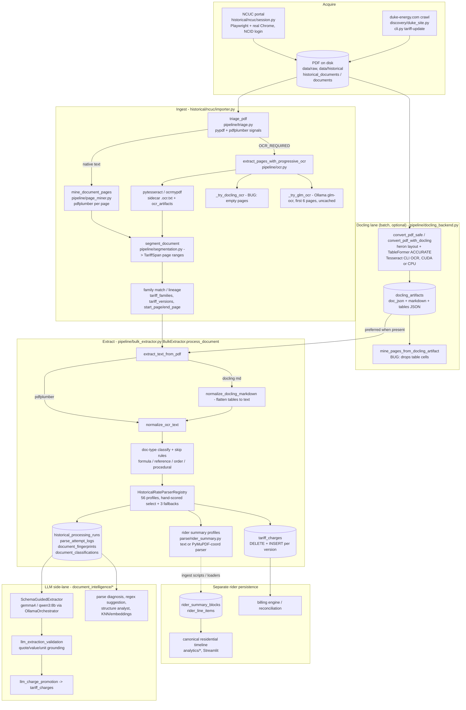

# Document Extraction Architecture Audit

**Date:** 2026-10-26
**Scope:** Read-only investigation of how `duke-rates` turns PDFs into tariff charges, and where newer document-understanding tools (MinerU, PaddleOCR-VL, GLM-OCR, better local-LLM extraction) could help.
**Method:** Source reading plus read-only SQL against `data/db/duke_rates.db` (opened `mode=ro`). No application code, configuration, DB rows, or artifacts were changed. The scratch query scripts used are listed in the appendix.

**Evidence labels used below**

- **[Confirmed]**: verified by reading the code path and/or measured against the live DB.
- **[Inferred]**: strongly suggested by the evidence but not proven end-to-end.
- **[Assumption]**: a judgement call or a claim about external tools, not verified in this repo.

---

## 0. Executive summary

1. **The pipeline is a text-first regex system.** Every engine (pdfplumber, PyMuPDF, Tesseract, Docling, GLM-OCR) is reduced to flat text before extraction. Docling's structured tables are rendered to Markdown and then flattened back to whitespace text (`normalize_docling_markdown`) so that 56 hand-written regex profiles can read them. Table structure, cell boundaries, and bounding boxes are discarded before the step that most needs them. **[Confirmed]**
2. **Two confirmed Docling integration bugs are cheap to fix and need no new engine:**
   - `mine_pages_from_docling_artifact` rebuilds page text from `texts[]` only. Table cells are never included: **2,336 of 2,362 (98.9%)** decimal values found in Docling table cells across the 40 most recent table-bearing artifacts are absent from the page text it produces. That text feeds page features, segmentation, and the OCR fallback. **[Confirmed, measured]**
   - The progressive-OCR path (`_try_docling_ocr`) passes `convert_pdf_with_docling`'s return dict to the page miner, but the keys don't match (`document`/`plain_text` vs. `doc_json_content`/`plain_text_content`). Every Docling OCR page therefore comes back **empty**, and the function can return those empty pages as its "best" result. **[Confirmed, reproduced]**
3. **The "149 merged rider-summary blocks" originate in section segmentation inside the text-based rider-summary parser** (`parse/rider_summary.py::_parse_rate_class_blocks`), not in profile selection or persistence:
   - A `TOTAL` row never closes a block. A block ends only when the next rate-class header regex matches, so a missed header merges two classes.
   - Whole compliance PDFs are fed in unbounded, so service lists and addresses get absorbed.
   - On re-measurement the real number is **≈130 merged blocks plus 28 legitimate single-class (¢/kWh + $/kW) blocks**. A further **26 "blocks" are orphan line items whose parent block was deleted** by a schema migration (1,204 orphan rows in total).
   - Only 2 merged blocks are labeled residential (DEC 2024-01 blk 304, DEC 2025-01 blk 307), but those 2 feed the residential timeline. **[Confirmed]**
4. **Of the 150 linked versions without charges, about 92 are expected or non-applicable**: formula-only, reference/service-regulation, program descriptions, procedural/order, redline, terminated EDIT-4, and misregistered documents. **About 58 are real extraction gaps**: 24 have no matching profile, 30 have a profile selected but return empty, and 4 are unclassified. A further 6–8 of the 21 `skipped_order` docs look like tariff sheets misclassified as orders (CAR, PIM, Leaf 601 BA, SCR-1, NSC, street lighting). **[Confirmed counts; misclassification Inferred]**
5. **Provenance is strong for runs and weak for charges.**
   - `tariff_charges` has no page number, bounding box, run id, parser version, or text-source column.
   - Reprocessing hard-`DELETE`s prior charges for the version (`BulkExtractor.insert_charges`). Only **55 of 331** LLM-promoted charges still exist.
   - `parser_version` is the constant `historical_bulk_v2` on all 41,179 runs, despite months of parser changes, so historical results are not reproducible by version.
   - Meanwhile about **2.6 GB of the 5.8 GB DB** is run/attempt `metadata_json` that embeds the full document text on every run (one document has 1,423 runs). **[Confirmed]**
6. **The LLM layer is well-instrumented but has two integrity gaps.**
   - It uses `format: "json"`, not a JSON schema, and Pydantic validation happens only after generation.
   - The "VLM" table path (`SchemaGuidedExtractor.extract_with_layout`) **never sends an image**. It appends a file path to a text prompt.
   - Source grounding of LLM rows (quote/value/unit checks against the source text) is good and should be preserved. **[Confirmed]**
7. **Recommendation, in order:**
   1. Fix the confirmed bugs and add charge-level provenance.
   2. Build a frozen benchmark from documents already in the repo, using the tariffs' own `TOTAL` rows and the 12 reconciled bills as ground truth.
   3. Adopt a single structured intermediate representation (one already exists, `DocumentRepresentation`, but is unused on the hot path).
   4. Only then trial MinerU, PaddleOCR-VL, or a VLM extractor behind that representation.

---

## 1. Current architecture



**Key shape [Confirmed]:**

- Ingest (page mining, segmentation, family binding) and extraction (text, profile, charges) are separate passes. They share only the PDF path, the page bounds, and cached artifacts.
- There is no single document object passed between stages. Each stage re-reads the PDF or an artifact and builds text again.
- Charges have **two persistence layers**: `tariff_charges` (generic) and `rider_summary_blocks`/`rider_line_items` (feeds the residential timeline). They are populated by different code paths and can disagree.

---

## 2. Inventory of parsing engines and models

| # | Engine | Entry point | Input → output | Deps / runtime | GPU | Cache | Failure handling | Consumed by |
|---|---|---|---|---|---|---|---|---|
| 1 | PyMuPDF text | [`extract_pdf_text`](../../src/duke_rates/parse/pdf_text.py) `parse/pdf_text.py:6` | PDF → plain text | `pymupdf 1.27.2.2` | no | none | falls back to pdfplumber, then raises | Duke-site leaf parsers (`parse/nc_progress.py`, `nc_carolinas.py`), `leaf_splitter` |
| 2 | pdfplumber page text | `page_miner.mine_document_pages` `pipeline/page_miner.py:317`; `BulkExtractor.extract_text_from_pdf` `bulk_extractor.py:657` | PDF page → text + `PageEvidence` features | `pdfplumber 0.11.9` | no | page artifacts in DB | returns `""` / `"none"` source | segmentation, all profiles |
| 3 | PyMuPDF span coordinates | `parse_rider_summary_from_pdf` `parse/rider_summary.py:253` | PDF → rows by x/y and bold spans | pymupdf | no | none | caller falls back to text parser (uncommitted fix in `parser_profiles.py:3110`) | `ProgressRiderAdjustmentMatrixProfile` only |
| 4 | Native tables | `extract_native_tables_for_page` `document_intelligence/native_tables.py:17` | page → `ExtractedTable` | pdfplumber; camelot optional (**not installed**) | no | none | empty list | document-intelligence side-lane only |
| 5 | Tesseract (pytesseract / ocrmypdf) | `extract_ocr_document_pages` `pipeline/ocr.py:245` | PDF → per-page OCR text | Tesseract binary (installed), pytesseract 0.3.13; ocrmypdf **not installed** (auto falls to pytesseract) | no | `.ocr.txt` / `.ocr.pages.json` sidecars + `ocr_artifacts` (353 rows, all `pytesseract_cpu`) keyed by file hash | tries next backend; returns `[]` | importer → segmentation; `raw_text_path` |
| 6 | Docling standard | `convert_pdf_with_docling` `docling_backend.py:335`, `convert_pdf_safe` `:1207` | PDF → DoclingDocument JSON + Markdown + table grids | `docling 2.91.0`, `docling-core 2.74.1`, `docling-ibm-models 3.13.2`, torch 2.6.0+cu124 (CUDA available); heron layout, TableFormer ACCURATE + cell matching, Tesseract CLI OCR only when `has_scanned_pages` | yes (CUDA/CPU) | `docling_artifacts` (1,964 rows; 439 PDFs have more than one) keyed by `source_pdf + file_hash + backend_version + accelerator` | `convert_pdf_safe`: chunking, per-page degradation (no OCR, then no tables, then CPU), GLM single-page rescue; partial success accepted | `BulkExtractor` text source (322 of 483 latest runs use `docling_artifact_sliced`) |
| 7 | Docling VLM (GraniteDocling / SmolDocling) | `_build_vlm_converter` `docling_backend.py:298` | page images → DocTags | transformers models | yes | same table | returns None | operator-invoked only; no production caller found |
| 8 | GLM-OCR (Ollama `glm-ocr:latest`) | `_try_glm_ocr` `pipeline/ocr.py:408`; `GlmOcrNormalizer` `document_intelligence/normalization.py:441`; `_try_glm_single_page` `docling_backend.py:847` | page PNG (2.5x) → text | Ollama on localhost | yes (Ollama) | **none** in `_try_glm_ocr` | logged, returns None | progressive OCR (first **6 pages only**, `ocr.py:430`), Docling page rescue, benchmarks |
| 9 | PaddleOCR / PP-Structure | `PaddleStructureNormalizer` `normalization.py:209` | page image → layout and tables | `paddleocr 3.4.0` installed **only in `.venv312-ocr`** (no torch/docling there) | yes | none | normalizer warnings | benchmark modules only (`benchmark/document_normalization_bench.py`) |
| 10 | Rider-summary text parser | `parse_rider_summary` `parse/rider_summary.py:202` | flat text → `RiderRateClassBlock`s | regex | no | n/a | warnings list | rider profiles, `persist_rider_summary_records` |
| 11 | 56 parser profiles | `HistoricalRateParserRegistry` `parser_profiles.py:6968` | doc dict + flat text → `ExtractedCharge` list | regex | no | n/a | `ValueError` caught per profile (`_safe_profile_extract` `bulk_extractor.py:1098`) | `tariff_charges` |
| 12 | Legacy ingest LLM | `parse/ingest_pipeline.py::_run_llm` `:380` | text → JSON | OpenAI `gpt-4.1-mini` when `DUKE_RATES_OPENAI_API_KEY` is set (key currently empty) | n/a | none | heuristic fallback | legacy ingest path |

**Local models referenced [Confirmed via `config/ollama_models.yaml` and `ollama list`]:**

| Role | Primary → fallbacks | Purpose |
|---|---|---|
| `structured_rate_extraction` | gemma4:e4b → qwen3:8b → qwen2.5-coder:7b | rate-row JSON extraction (365 ok, 68 timeouts, 25 validation errors) |
| `structured_rate_classify` | qwen3:8b → mistral:7b → qwen2.5:7b | per-line classification (1,551 ok) |
| `structured_extractor` | glm-4.7-flash → **command-r (not installed)** | metadata extraction |
| `balanced_classifier` / `fast_classifier` | qwen3:8b / smallthinker | document-type adjudication |
| `document_structure_analyst` | llama3.1:8b → qwen2.5-coder:7b | section boundary refinement (3,423 ok, 207 validation errors) |
| `parse_failure_triage`, `hard_parse_diagnosis`, `regex_suggestion`, `heavy_reasoning` | mistral:7b, qwen2.5-coder:7b, llama3.1:8b, deepseek-r1:14b | diagnosis and regex authoring (not extraction) |
| `vision_layout`, `layout_table_extraction` | qwen3-vl:4b | **VLM roles, but no code path sends images to them** (see §4) |
| `ocr_fallback` | glm-ocr | OCR |
| embeddings | qwen3-embedding:0.6b, bge-m3, snowflake-arctic-embed2, nomic-embed-text | KNN document/section classification |

Pulled but unreferenced in code: `tb-etl/mineru-q4km` (a community GGUF, not the MinerU pipeline), granite4.1:8b, ministral-3:8b, nemotron-3-nano:4b, qwen3.5:9b, phi4-mini. **MinerU and PaddleOCR-VL have no integration code.** **[Confirmed]**

**Common intermediate representation: one exists but isn't on the hot path.** `DocumentRepresentation` / `PageRepresentation` / `LayoutBlock(bbox)` / `ExtractedTable` in [`document_intelligence/models.py:125`](../../src/duke_rates/document_intelligence/models.py), with a `DocumentNormalizationRouter` (`normalization.py:589`) over Native, Paddle, and GLM normalizers, is a good design. In production, though, `BulkExtractor._analyze_document_intelligence` (`bulk_extractor.py:2000`) builds it **after** extraction, from the raw text, for diagnostics only. Profiles never receive it. The de-facto contract is `str` plus the `doc` dict. **[Confirmed]**

---

## 3. Docling integration details

| Item | Finding |
|---|---|
| Version | docling 2.91.0, docling-core 2.74.1, docling-ibm-models 3.13.2 (`.venv312`). Cache key constant `DOCLING_BACKEND_VERSION="docling_v2"` (`stage_versions.py`) is independent of the package version. **[Confirmed]** |
| Layout | `DOCLING_LAYOUT_HERON` if importable (`_build_standard_converter` `docling_backend.py:238`) |
| Tables | TableFormer **ACCURATE**, `do_cell_matching=True`. `_extract_tables_from_doc` keeps only `rows[:20]` per table in `tables_json_content` (`docling_backend.py:230`). Full grids survive in `doc_json_content`. |
| OCR | `do_ocr = has_scanned_pages`. TesseractCLI `lang=["eng"]`, `force_full_page_ocr=False` unless requested. |
| Images | `generate_page_images=False`, `generate_picture_images=False`. **Page images are not retained**, so no image crops are available for VLM verification. |
| Accelerator | CPU default; CUDA when requested. Artifacts: 1,316 cuda SUCCESS, 365 cpu SUCCESS, 174 PARTIAL_SUCCESS, 107 legacy `"success"` strings. |
| DoclingDocument preserved? | Yes, as `export_to_dict()` JSON in `docling_artifacts.doc_json_content` (459 MB). Markdown in `plain_text_content`. |
| Page geometry / provenance | Preserved in the stored JSON (`prov[].page_no`, `prov[].bbox`), but **discarded downstream**. Nothing reads bbox except the `t`-coordinate sort in the page miner. |
| Conversion to extraction input | `BulkExtractor.extract_text_from_pdf` (`bulk_extractor.py:657`) **prefers any usable Docling artifact over pdfplumber**. Unbounded: Markdown. Bounded: `_slice_docling_text` (`:507`) walks `body.children` and renders tables to Markdown. Then `normalize_docling_markdown` (`ocr_normalization.py:163`) flattens `| a | b |` to `a b` and the regex profiles run. |

**Limitations fixable without a new engine** (all **[Confirmed]** unless marked):

1. **D1. Page miner drops tables.** `mine_pages_from_docling_artifact` (`docling_page_miner.py:44`) iterates `doc_json["texts"]` only and counts tables without emitting their cells. Measured loss is 98.9% of table decimal values. It also orders lines by `bbox.t` alone (no x-ordering, no column grouping), which interleaves multi-column layouts.
2. **D2. Docling OCR fallback returns empty pages.** `_try_docling_ocr` (`ocr.py:383`) passes a dict keyed `document`/`plain_text`, but the miner reads `doc_json_content`/`plain_text_content`. A reproduction gives page text lengths `[0, 0]`. Separately, `extract_pages_with_progressive_ocr` returns `best_pages` labeled `attempted[-1]` (`ocr.py:522`), which can attribute text to the wrong backend.
3. **D3. Stale artifact selection.** `BulkExtractor._load_docling_artifact` (`bulk_extractor.py:430`) picks `ORDER BY id DESC` by `source_pdf` **without checking `file_hash`**. Because downloads can overwrite a PDF at the same path (documented in the 2026-06-05 session), extraction can read Docling text from a superseded revision. **[Confirmed code; occurrence Inferred]**
4. **D4. Cache key ignores conversion options.** The key omits degradation flags (no-OCR, no-tables, chunked), so a degraded conversion satisfies later full-quality requests.
5. **D5. Chunk-relative page numbers.** Some chunked artifacts carry chunk-relative `page_no`. `_slice_docling_text` detects this heuristically and falls back to pdfplumber (`:566`), silently changing the text source.
6. **D6. Structure is thrown away.** The Markdown-then-flatten step removes cell boundaries. Multi-value rows (e.g. "TOTAL cents/kWh 1.3513 0.278") become ambiguous for the regexes.
7. **D7. Version and status normalization.** Statuses are stored in three spellings, matched by substring (`_docling_status_is_usable`). The `OCR_BACKEND_VERSION` constant `"pytesseract_cpu_v1"` is recorded regardless of the backend actually used.

---

## 4. Local LLM integration

| Question | Finding |
|---|---|
| Classification models | qwen3:8b (`balanced_classifier`), smallthinker / qwen3.5:4b (fast), embedding KNN (qwen3-embedding:0.6b, bge-m3). 30,721 `document_classifications` rows, mostly `section_knn_v1`. |
| Structured extraction | gemma4:e4b, then qwen3:8b for rows; staged find-lines then classify-line (`document_intelligence/schema_extraction.py::SchemaGuidedExtractor`). |
| Vision-language models | Roles are configured (`qwen3-vl:4b`). **`extract_with_layout` (`schema_extraction.py:965`) sends text only and appends `"A page image is available at: <path>"` to the prompt**, so the model never sees pixels. GLM-OCR is the only image path in use. **[Confirmed]** |
| JSON schemas enforced? | **No.** `OllamaOrchestrator._call_model` sets `payload["format"]="json"` (`ollama_orchestrator.py:473`), not a JSON schema. Pydantic `model_validate` runs afterwards (`:529`), and a failure triggers fallback to the next model. Ollama supports schema-constrained `format` **[Assumption about current Ollama]**, which would cut the observed validation errors (207 + 25 + more). |
| Hallucination / malformed handling | Good. `llm_extraction_validation._validate_rate_row` (`:253`) requires the quote to be found in the source text and the value to appear in the quote; it also infers units from nearby headers. Rows are "rejected" when the quote or value is ungrounded. `llm_row_evidence_locator` asks a second model only to *locate* unit evidence, not to invent values. Promotion requires eligible + novel + no conflict (`llm_charge_promotion.promote_llm_charge_proposals` `:97`). |
| Validated against source? | Yes, textually (quote and value), against the same flattened text the regexes see. Not against page coordinates or images. |
| Reproducibility | Partial. `temperature: 0.0` everywhere, but **no `seed`**. `prompt_versions` are all still `v1` despite prompt changes. `ollama_model_runs.raw_payload` is truncated (`_truncate`), and model digests are not recorded (tags such as `:latest` drift). |
| Survival of LLM results | 331 proposals promoted, **55 promoted charge rows still exist**. The later deterministic reprocess `DELETE`s every charge for the version (`insert_charges` `bulk_extractor.py:1915`), and the late-May cleanups removed more. `llm_promoted_charge_audit` now points at deleted ids. **[Confirmed counts; cause split Inferred]** |

---

## 5. Deterministic parser profiles

**Selection [Confirmed]:**

- `HistoricalRateParserRegistry.rank_candidates`/`select` (`parser_profiles.py:8328`/`:8343`) scores every profile via `_score_profile` (`:7085`). That function is about **1,240 lines of hand-written `if profile_name == ...` rules** over `ParserProfileSignals`: family_key, leaf number, path, title, and roughly 12 text-marker booleans, plus hard-coded family allowlists (e.g. `zero_charge_program`).
- The highest score wins. `recommend_fallback_sequence` (`:8351`) supplies up to 3 more candidates, and `BulkExtractor._should_apply_fallback` (`bulk_extractor.py:1154`) adopts one only on measurable gains (more charges, more charge types, TOU or season coverage, field completeness).
- A guard refuses `generic_residential` as a fallback for family-specific docs. Multiple parsers *are* attempted per document, and every attempt is logged in `selection_details.fallback_attempts`.

**Layouts supported:**

- 60 profile classes, 56 registered: 31 Progress, 23 Carolinas, plus generic, zero-charge, and unsupported.
- Specialized handling covers residential flat and TOU (DEP leaf 500/501, DEC RS), the rider summaries (DEP Leaf 600, DEC Leaf 99), JAA, billing adjustments BA, street and outdoor lighting, CPRE, fuel cost adjustment, NPTC, net metering, EE/DSM, CEPS, flat-fee riders, and the LGS-RTP and medium-GS schedules.

**Coordinate dependence:**

- Only `parse_rider_summary_from_pdf` uses positions, with fixed x thresholds (`_X_LABEL_MAX=300`, `_X_DATE_MIN=400`, `_X_INDENT_THRESHOLD=85`, `rider_summary.py:344-352`).
- That is brittle by construction. It silently returned 0 classes on the June 2026 Leaf 600 layout, which is why the uncommitted fallback was added.
- Every other profile is pure regex over flattened text.

**Unknown layouts:**

- These end in `UnsupportedDocumentProfile` ("unknown") with 0 charges.
- `generic_residential` (a broad `$N.NN/unit` harvester) is allowed only as an initial pick.

**Quality measurement:**

- `_assess_extraction_outcome` (`bulk_extractor.py:2344`) produces strong / weak / empty / skipped / failed from selector score (< 0.65 is weak), charge count (≤ 1 is sparse), and the generic-fallback flag.
- There is **no numeric validation** at this layer: no total-equals-sum-of-components check, no unit-range check, no comparison with the prior version.
- `tariff_charges.confidence_score` is filled for every row but comes from profile constants rather than measured evidence. **[Confirmed for the profiles inspected]**

### 5.1 The merged rider-summary blocks: root cause

Re-measured on the live DB (`rider_summary_blocks` = 365, `rider_line_items` = 8,003):

| Category | Blocks | Meaning |
|---|---:|---|
| merged sections + non-summary text | 65 | two or more ¢/kWh sections plus addresses, "Leaf No." headers, and so on |
| merged sections + multi-number TOTAL | 30 | e.g. `"TOTAL cents/kWh 1.3513 0.278"` (two columns in one TOTAL) |
| merged sections only | 19 | clean riders but two class sections in one block |
| merged + non-summary + multi-number | 16 | |
| **merged subtotal** | **130** | |
| ¢/kWh + $/kW TOTAL in one class (legitimate) | 28 | false positives of the ">1 TOTAL" heuristic |
| orphan line items (parent block deleted) | 26 | 1,204 orphan rows across 72 missing block ids |

**Root cause by stage:**

- **Section segmentation (primary). [Confirmed]** In `_parse_rate_class_blocks` (`rider_summary.py:836`) a new block starts only when a header matches `_extract_block_header`, `_CLASS_INLINE_RE`, or a class-name-then-column-header pair. `_parse_one_block` (`:936`) treats `TOTAL` as an ordinary item and does not close the block, so `block.total_cents_per_kwh` is **overwritten by the last TOTAL**.
  - Example: blk 307 (DEC 2025-01 "Residential Schedules") contains the residential section (TOTAL 0.1125) followed by a second section with different FCA/EE values (TOTAL 0.2487). The stored block total is 0.2487.
  - **[Inferred]** The second section is General Service: same rider set, CAR absent, values consistent with the GS column. The 2026-05-31 note recorded this as "two rate periods". The evidence points instead to two **rate classes**.
- **Document bounding.** Unbounded compliance PDFs are parsed whole. Blk 361 (DEC E-7 Sub 1146 FCA filing) absorbed three sections plus about 45 service-list address lines.
- **Column handling.** `_DATA_ROW_RE` (`:174`) captures `val1 → cents_per_kwh`, `val2 → dollars_per_kw` by position, with no column-header awareness. In demand classes a single $/kW value lands in `cents_per_kwh`; for example blk 13, line 254: "JAA 1.72" sits under "TOTAL dollars/kW 1.72". In total, 178 JAA rows carry `cents_per_kwh > 1`. **[Confirmed example; full extent Inferred]**
- **Profile selection: not the cause.** The same text parser is used regardless of which rider profile is chosen.
- **Persistence: a secondary defect.** `persist_rider_summary_records` (`db/ncuc_loader.py:118`) stores whatever blocks the parser emits. The orphans come from migration TD-002 in `db/schema.py:1226`, which deletes duplicate `rider_summary_blocks` without deleting their `rider_line_items`. SQLite foreign keys are not enabled (no `PRAGMA foreign_keys=ON` in `db/`), and the migration re-runs on every schema initialization. Also, `UNIQUE(docket_dir, source_pdf, rate_class, effective_date)` cannot dedupe the 64 blocks with `effective_date IS NULL`, because NULLs are distinct in SQLite unique indexes.
- **Downstream mitigation.** `canonical_rider_components._load_clean_leaf600_components` (`analytics/canonical_rider_components.py:431`) dedupes by `(effective_date, rider_code)` and keeps the first row. That accidentally picks the first (residential) section for blk 307, but it doesn't use the block total, and the `ABS(cents_per_kwh) <= 5.0` filter is the only unit guard.

**Residential impact:** only blks 304 and 307 are residential-labeled merges. The GS and industrial merges affect non-residential analytics and any consumer of `total_cents_per_kwh`.

---

## 6. Extraction coverage: the 150 versions without charges

Population: NC `tariff_versions` joined to `historical_documents` = 526, of which 376 have charges and 150 have none. Classification uses the latest `historical_bulk` run for each version (script `q5.py`).

| Category | n | Should it have charges? |
|---|---:|---|
| `skipped_order` (classifier: order/letter) | 21 | Mostly no (program descriptions, 2025 EE program leaves). **About 6–8 look like real rider sheets misrouted**: CAR (hd 7295, 7764), PIM (7545), Leaf 601 BA span 51 (7250), SCR-1 (7612), NSC (7693), street lighting leaf 571/572 (174, 176). **[Inferred]** |
| `skipped_reference` (service regs, EV programs, rule orders) | 19 | No |
| `skipped_formula` (PPS, CEI, SBES, SSP, LWP…) | 18 | No fixed value; formula-based |
| `zero_charge_program` profile | 15 | No (allowlisted) |
| `skipped_procedural` | 10 | No (one, `LGS (Span 31-31)` hd 7166, is a known open question) |
| `skipped_redline` | 3 | No (the clean version should carry charges) |
| `skipped_other` / descriptions | 1 | No |
| version status `misregistered_document` | 3 | No (wrong doc bound) |
| never processed (EDIT-4 terminated 2026-06-01) | 2 | Correctly zero (rider terminated) |
| **Expected / non-applicable subtotal** | **≈92** | |
| `unknown`: no profile matched | 24 | **Gap.** Families: Carolinas PM, IS, PS, NL, I; DEP 642 GreenPower, 645, 664 SSR, 591 PPBE T&C, 611 CAR, 602 JAA, 601 BA |
| profile selected, returned empty | 30 | **Gap.** JAA leaf-602 (5 docs), single-value riders on 2015 compliance-bundle pages (646/647/648/649/652), CPRE 605, CAR 611, RDM 608, PPBE, NPTC 2026-01-01, DEC RS 1993 (scan), DEP R-TOUD 2014, SGS-TOUE 2014 |
| `skipped_unknown` | 4 | Probably no (EE program docs) |
| **Real gap subtotal** | **≈58** | |

Text source of the latest run per NC doc: `docling_artifact_sliced` 322, `pdfplumber` 159, none (skipped before text metrics) 131, `docling_artifact` 2. Empty-profile failures occur under both sources, which points at profile regexes and layout, not only at OCR quality. **[Confirmed]**

**Note on totals:** `tariff_charges` is 5,198 rows today against 26,638 in the 2026-05-11 eval snapshot. That fall is the documented late-May cleanup (cross-attribution and noise removal, roughly 30,530 → 5,168; see commits `91d14f7`, `dc128a5`, `cecb23d`, `ff74300`), not data loss. **[Confirmed via commit history and session notes]**

---

## 7. Database and provenance

```
documents (Duke-site crawl) ──current_document_id──► tariff_families ◄── family_key ── tariff_versions ──► tariff_charges
historical_documents (NCUC/archive, start_page/end_page, content_hash, raw_text_path) ──historical_document_id──┘
historical_documents ─(source_pdf)─► docling_artifacts / ocr_artifacts / page & span artifacts
historical_documents ─► historical_processing_runs (41,179) / parse_attempt_logs (64,064) / parse_review_outcomes (61,692)
rider_summary_blocks (source_pdf, rate_class, effective_date) ─► rider_line_items           (no link to tariff_versions)
llm extraction → llm_candidate_rate_row_validations → llm_rate_charge_promotion_proposals → tariff_charges (+ audit)
document_classifications (supersedable, classifier + version), document_type_gold (441), section_type_gold (964)
```

| Capability | Status |
|---|---|
| Multiple extraction runs per document | **Yes.** `historical_processing_runs`, `parse_attempt_logs` |
| Preservation of previous *charges* | **No.** `insert_charges` deletes prior rows for `(version_id, family_key)` (`bulk_extractor.py:1915`); `replace_parsed_tariff_data` deletes **all versions** of a family (`db/repository.py:4970`, used by `tariff-update --auto-parse`, `cli.py:1228`/`:1465`); `persist_rider_summary_records(replace=True)` deletes line items; migration TD-002 deletes blocks |
| Parser/model version tracking | Runs: `parser_version` column is always `historical_bulk_v2`; profile name recorded. Charges: none. LLM: model tag and prompt version, but no digest or seed |
| Source-page references | Document-level `start_page`/`end_page` only. Charges carry `source_snippet` (5,163/5,198) but no page |
| Bounding boxes | Only inside Docling JSON. `evidence_anchors` table exists but is empty (0 rows) |
| Extraction confidence | `confidence_score` on every charge (profile constant); selector score on runs |
| Human review / approval | Partial. `parse_review_outcomes`, gold tables, `tariff_versions.status` (approved / pending_document / misregistered_document), manual-insert notes on charges. No per-charge approval state or reviewer identity |
| Storage hygiene | 20,649 runs embed `text_metrics.full_text` (`bulk_extractor.py:1595`). Run + attempt `metadata_json` total about 2.6 GB of the 5.8 GB DB |

**Places where reprocessing can destroy history:**

1. `insert_charges` DELETE-then-INSERT (and `force_clear` empties a version).
2. `replace_parsed_tariff_data` family-wide DELETE (already documented as a trap).
3. Rider-block `replace=True` and the TD-002 migration (orphans line items).
4. `DocumentDownloader.build_archive_path` overwriting PDFs at a deterministic path (documented 2026-06-05). The Docling artifact lookup by path (D3) then compounds this.
5. Cleanup scripts that hard-delete charges with no tombstone.

---

## 8. Benchmarking feasibility

**Already present [Confirmed]:**

- **Parser and unit tests:** 177 test files, including `test_rider_summary_parser.py`, `test_historical_parser_profiles.py`, `test_docling_page_miner.py`, `test_ocr_normalization.py`, `test_llm_extraction_validation.py`, `test_tariff_engine_live.py`. Most use inline text strings. `tests/fixtures/` holds only 2 PDFs.
- **Billing reconciliation:** 12 saved Duke bills (`..\version_3\Actual Duke Bills\*.pdf`); `data/processed/bill_accuracy/*` reports 12/12 good_match, max delta $0.45. This is the strongest end-to-end ground truth.
- **Gold sets:** `document_type_gold` (441), `section_type_gold` (964), `docs/research/gold_set_v0.jsonl`, `tests/rag_eval_set.yaml`. These are classification gold, **not charge-value gold**.
- **Engine benchmarks:**
  - `benchmark/pipeline_bench.py` (Docling CPU vs GPU timing by category A–E)
  - `document_normalization_bench.py` and `document_page_text_compare.py` (native vs Paddle vs GLM text, expected-token checks)
  - `redline_analysis_bench.py`
  - `document_intelligence/model_benchmark.py` (LLM role benchmarks)
- **Missing:** a frozen PDF corpus with **expected charge records** (value, unit, class, TOU/season, effective date, page), and a harness that scores extraction output against it.

**Built-in ground truth worth exploiting:**

- **Rider summary `TOTAL` rows are printed checksums.** The sum of components must equal the TOTAL, per rate class and per unit.
- **Version continuity:** unchanged riders between consecutive revisions should carry identical values.
- **Bills:** each bill line maps to (rider, ¢/kWh, date).

### 8.1 Proposed benchmark framework

```
bench/
  corpus.yaml           # doc_id, sha256, source_pdf, page range, category, why-selected
  expected/<doc_id>.json # list of ExpectedCharge (below), produced by human review, never by the system under test
  runners/              # one adapter per candidate -> DocumentRepresentation -> charges
  score.py              # per-doc, per-field metrics; writes bench_results table/CSV
```

**`ExpectedCharge`** fields: `family_key`, `rate_class`, `charge_type`, `label`, `value` (Decimal, as printed), `unit` (¢/kWh | $/kW | $/month | %), `tou_period`, `season`, `tier_min/max`, `effective_date`, `page`, `bbox` (optional), `applicability` (schedules list), `expected_zero` (bool, for negative controls).

**Candidates to run:**

- (a) current pipeline as-is
- (b) current pipeline with the D1–D3 fixes
- (c) Docling structured tables fed straight to a table-aware extractor (no flattening)
- (d) MinerU (PDF → Markdown/JSON with tables and bboxes) **[Assumption: capabilities as advertised]**
- (e) PaddleOCR-VL / PP-StructureV3 (in `.venv312-ocr`)
- (f) GLM-OCR text plus the existing profiles
- (g) a VLM extractor (qwen3-vl or similar) given page images and a schema-constrained output, verified against the text layer

**Metrics, in priority order:**

1. **Value accuracy:** exact match on the printed value (string-normalized Decimal), per charge.
2. **Unit accuracy:** exact unit; any ¢/$ or kWh/kW swap is a hard failure.
3. **Applicability:** rate class and schedule list correct; no cross-class leakage (the blk 307 failure mode).
4. **Effective date:** version date and per-line date.
5. **Completeness:** recall of expected charges, and precision (spurious charges, especially on expected-zero docs).
6. **Checksum pass rate:** for summary sheets, Σ components equals the printed TOTAL to within 0.0001.
7. **Provenance:** a page and a quote (or bbox) that contains the value, verified automatically.
8. **Cost:** wall time per page, peak VRAM, CPU/GPU, model size, cache reuse, determinism (run twice and diff).
9. **End-to-end:** the 12-bill reconciliation delta when candidate output replaces the current `tariff_charges` in a scratch DB copy.

---

## 9. Major accuracy and reliability risks (ranked)

| # | Risk | Evidence | Impact |
|---|---|---|---|
| R1 | Rate-class leakage in rider summaries | §5.1: about 130 merged blocks; residential blks 304/307 | Wrong totals feed timelines and comparisons |
| R2 | Units by column position ($/kW stored as ¢/kWh) | blk 13 JAA; 178 JAA rows > 1 | Silent unit errors that slip past a 5¢ cap |
| R3 | Structure discarded before extraction | §3 D1/D6 | Profiles break on any layout drift (Leaf 600 June 2026) |
| R4 | Destructive reprocessing and no charge provenance | §7 | Cannot audit or roll back; LLM promotions erased (276/331) |
| R5 | Non-reproducible results | constant `parser_version`, no LLM seed or digest, path-keyed artifacts | Cannot attribute regressions; 23 failing tests today |
| R6 | Stale or overwritten source binding | D3 plus path overwrite | Text from a different revision attributed to a version |
| R7 | Hand-scored profile routing (about 1,240 lines) | `_score_profile` | High change cost; 24 docs fall to `unknown` |
| R8 | Classifier gating before extraction | 6–8 rider sheets marked `order` | Real charges never attempted |
| R9 | Broken fallbacks give false confidence | D2 (Docling OCR empty), VLM path without images | Escalation ladder reports success with no content |
| R10 | DB growth from duplicated full text | 2.6 GB of metadata | Slow queries, backups (5.8 GB) |

---

## 10. Capabilities to preserve

- **Page-bounded spans** (`start_page`/`end_page`) and segmentation of compliance books. This is the foundation of document-to-version binding.
- **Profile fallback with measured gains** and the cross-attribution guard for `generic_residential` (`_should_apply_fallback`).
- **Skip categories** (formula, reference, procedural, redline, zero-charge allowlist). These encode domain knowledge about what should *not* have charges.
- **`convert_pdf_safe`'s fault tolerance:** chunking, degradation ladder, CPU retry, partial-success acceptance.
- **The DB-first artifact cache keyed by file hash** (fix the lookup, keep the design).
- **LLM grounding:** quote-in-source, value-in-quote, and unit inference from headers; staged find-then-classify; candidate-only, guarded promotion with an audit table.
- **`OllamaOrchestrator`** role abstraction, fallbacks, and `ollama_model_runs` logging.
- **`DocumentRepresentation` models** (`BoundingBox`, `LayoutBlock`, `ExtractedTable`). These are the right contract to promote.
- **OCR normalization** for cent-sign mangling and redline fixes (`ocr_normalization.py`, `parse_nc_carolinas_leaf`).
- **Bill reconciliation** (12/12) as the end-to-end acceptance test.
- **The `rider_summary_blocks` / `rider_line_items` component model** (effective date per line) used by the timeline.

---

## 11. Modernization opportunities

**Tier 0: correctness fixes, no new engine**

1. **D1.** In `mine_pages_from_docling_artifact`, walk `body.children` in reading order and emit table cells row by row; sort by (page, `t`, `l`).
2. **D2.** Make `_try_docling_ocr` hand the miner `doc_json_content`/`plain_text_content` (or normalize keys once), and report the backend that actually produced `best_pages`.
3. **D3.** Filter Docling artifact lookup by `file_hash = hash(local_path)`; add conversion options to the cache key.
4. **Rider summary parser:**
   - Close a block at each `TOTAL cents/kWh` and start the next on the following header or rider row.
   - Map columns using the detected column header (single, double, triple layouts) rather than position.
   - Bound parsing to the summary pages.
5. **TD-002:** delete child line items (or enable foreign keys with `ON DELETE CASCADE`); stop re-running destructive dedupe on every init.
6. **VLM path:** actually send the page image, or remove the role until it is wired.

**Tier 1: provenance and reproducibility**

7. Add `extraction_run_id`, `page_number`, `bbox_json`, `text_source`, and `parser_version` to `tariff_charges` (or a sibling `charge_provenance` table). Bump `HISTORICAL_BULK_PARSER_VERSION` on every profile change; consider a hash of `parser_profiles.py` per run.
8. Replace DELETE-then-INSERT with versioned extraction sets: insert a new run's charges with `run_id`, mark the active set, and keep superseded rows (soft-delete). This keeps LLM-promoted and manual rows from being erased.
9. Store full text once per (document, text_source, hash) in an artifact table and reference it from runs. That reclaims about 2.5 GB.
10. LLM calls: pass a JSON schema in `format`, set `seed`, and record the model digest from `/api/show`.

**Tier 2: one structured intermediate representation**

11. Make `DocumentRepresentation` the single input to extraction: pages, blocks with bbox, and tables as cell grids with header rows. Adapters: pdfplumber/PyMuPDF (native), Docling (already rich), OCR, and later MinerU and PaddleOCR-VL. Profiles get a table-aware API (`find_table(header_contains=...)`, `column_for_unit(...)`) and fall back to `.text` during migration.
12. Add numeric validators at extraction time: checksum (Σ = TOTAL), unit-range by charge type, the same rider having the same value across adjacent revisions, and the residential rider stack within an expected band.

**Tier 3: evaluate new engines (behind Tier 2 plus the benchmark)**

13. **MinerU**, for compliance bundles and table-heavy summaries. Value is judged by checksum pass rate and value/unit accuracy versus Docling ACCURATE. **[Assumption]**
14. **PaddleOCR-VL / PP-StructureV3**, for pre-2010 scans. Needs to be reconciled with the separate `.venv312-ocr` environment (run as a subprocess worker that writes `DocumentRepresentation` JSON).
15. **VLM schema extraction** (page image plus text layer → rows, schema-constrained) for the 24 `unknown` and 30 empty-profile documents, with every value re-grounded in the text layer or OCR before promotion.
16. **Learned routing:** replace parts of `_score_profile` with the existing embedding KNN and section gold (964 rows) as a candidate generator, keeping rule scoring as the tiebreaker.

---

## 12. Prioritized roadmap

| Phase | Work | Exit criteria | Size |
|---|---|---|---|
| **P0** | Commit or settle the two June fixes; triage the 23 failing tests (10 live-DB engine tests, 4 page-miner heading tests, 3 profile-selection tests, OCR env); install `scikit-learn` in `.venv312` | Suite green or failures documented as data drift | S |
| **P1** | Build `bench/` v0 from §13 (start with 25 docs); write `expected/*.json` by human review; implement `score.py` for metrics 1–7; record baseline for the current pipeline | Baseline report committed | M |
| **P2** | Tier 0 fixes D1–D3, rider-summary block and column fixes, TD-002 orphans, unit guard | Benchmark: checksum pass rate up, zero unit swaps on the rider-summary subset, blk 307-class leakage gone; bills still 12/12 | M |
| **P3** | Tier 1 provenance: charge provenance columns, versioned extraction sets, parser version stamping, text dedupe, LLM schema/seed/digest | Re-running extraction is non-destructive; any charge traces to run, page, and quote | M |
| **P4** | Tier 2: `DocumentRepresentation` as extraction input; table-aware profile API; port rider summary, JAA, and single-value riders first | Same or better benchmark with fewer regex special cases | L |
| **P5** | Tier 3 bake-off: MinerU, PaddleOCR-VL, and VLM extraction as `DocumentRepresentation` adapters on the benchmark (accuracy and cost) | Data-driven engine choice per document category | M |
| **P6** | Targeted coverage: the 58 gap docs plus the 6–8 misrouted `order` docs, using the winning lane | Version coverage measured against the expected-applicable denominator (about 434, not 526) | M |

---

## 13. Proposed benchmark dataset (from documents already in the repo)

IDs are `historical_documents.id` (hd), `tariff_versions.id` (v), or `rider_summary_blocks.id` (blk). For each, `expected/*.json` should be hand-verified against the PDF.

| Category | Docs | Why |
|---|---|---|
| **A. Rider summaries: native, current** | DEP Leaf 600 Tenth Revised 2026-06-01 (v7311, 132 charges); DEP Ninth 2026-04-01 (v5891); DEC Leaf 99 Sixty-Seventh 2026-06-01 (v7312); DEC Sixty-Sixth 2026-01-01 (v5081) | Checksummed totals; known-good values; the June layout that broke the coordinate parser |
| **B. Rider summaries: merged / multi-column** | blk 307 source (DEC Rev 63, 2025-01-01); blk 304 source (E-7 Sub 1285); blk 13 source (e-2-sub-1300 `176ad684…pdf`, HP/LGS $/kW); blk 361 source (E-7 Sub 1146 FCA filing with service list) | Rate-class separation, unit columns, document bounding |
| **C. Residential base and TOU** | DEP leaf-500 hd 29 (Docling body.children orphan case); DEP R-TOUD 2014 hd 7378 (empty); DEP R-TOUD hd 3199; DEC RS hd 1975 (4-column table); DEC RS 1993 hd 7380 (scan, empty) | Base energy/customer charges; TOU and seasons; old scans |
| **D. JAA leaf-602** | hd 179, 7365, 5324, 5294 (empty) plus one passing JAA version | Most frequent empty-profile family |
| **E. Single-value riders in 2015 compliance bundle** | hd 378, 379, 380, 381 (Spans 156–159) | Short single-page riders inside a big bundle; mixed pdfplumber/Docling sources |
| **F. Large compliance books** | hd 7476 (IS, Span 109–194); hd 7480 (PPBE, Span 1–170); one E-2 Sub 1300 bundle | Segmentation and throughput/cost |
| **G. OCR-mangled values** | RIDER LC `ncriderlc-pdf.pdf` (manually inserted charges); a BPM recovery doc (2026-05-28 `b787ba3`); a pre-2000 Carolinas scan | Cent-sign and digit corruption; OCR engine comparison |
| **H. No-profile families** | Carolinas PM (hd 458), IS (1957), PS (7287, 7705), NL (456); DEP 642 GP (7296), 664 SSR (396), 611 CAR (7773) | Candidates for new-engine/VLM lanes |
| **I. Misrouted "order"** | CAR (7295), PIM (7545), Leaf 601 BA span 51 (7250), SCR-1 (7612), NSC (7693) | Classifier gating errors |
| **J. Negative controls (expected zero)** | leaf-660 PPS (392), leaf-672 CEI (403), leaf-703 program (408), leaf-800 service regs, JAA rule order (182), EDIT-4 terminated (7819) | Precision: no spurious charges |
| **K. End-to-end** | 12 saved bills, 2025-04 → 2026 (`..\version_3\Actual Duke Bills`) | Bill delta ≤ $0.50 must hold |

Suggested v0: 2–3 documents per category (about 30 documents), roughly 400–600 expected charges, dominated by the checksum-bearing rider summaries.

---

## Appendix: reproduction

Read-only scripts (scratchpad, not committed):

- `q2.py` re-classifies multi-TOTAL rider blocks and counts orphans.
- `q5.py` classifies the 150 charge-less versions and the text-source mix.
- `q6.py` measures table-value loss in `mine_pages_from_docling_artifact`.
- `q7.py` covers storage, run versioning, LLM promotion survival, and classifier mix.

**Environment snapshot (2026-10-26):**

- `.venv312`: Python 3.12.10, docling 2.91.0, torch 2.6.0+cu124 (CUDA available), pymupdf 1.27.2.2, pdfplumber 0.11.9; no paddle, camelot, ocrmypdf, or scikit-learn.
- `.venv312-ocr`: paddleocr 3.4.0, paddlepaddle 3.3.1, scikit-learn 1.8.0; no torch or docling.
- Ollama: 29 local models (listed in §2).
- Test suite: 1,441 passed, 23 failed (with `test_baseline_classifier.py` excluded for missing scikit-learn).
