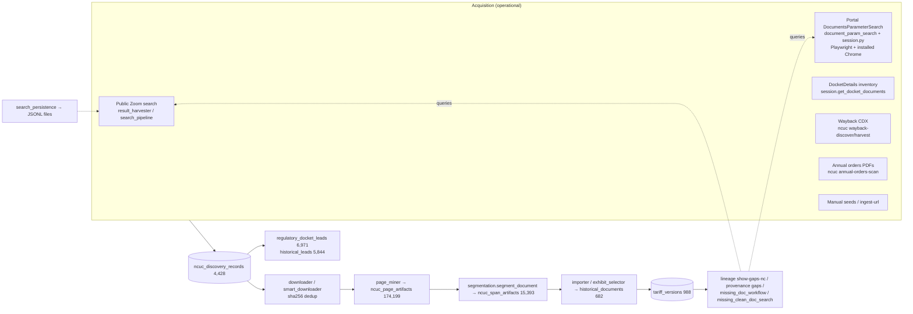

# Phase 2E M2: Document Discovery and Regulatory Lineage Assessment

**Date:** 2026-10-28
**Type:** read-only investigation and plan. No discovery, lineage, segmentation or search code was changed in this part.
**Branch:** `phase2e/m11-fallback-correctness` (report only).
**Data:** scratch copy `m11.db` of production (opened `mode=ro`). External repositories read through the GitHub API, nothing cloned or installed.
**Companion:** `docs/design/2026-10-28_next_document_discovery_milestone.md` (the one recommended next phase).
**Prior work this builds on:** `docs/reports/2026-10-28_architecture_reconciliation.md`. Its §7 covers segmentation and its roadmap names M2–M6. This report does not repeat its findings; it adds measurements.

Evidence labels used below:
- **[Measured]**: counted on the scratch DB or the archive this session.
- **[Read]**: from reading the code.
- **[External]**: from a third-party repository, not re-verified against the live NCUC portal (no portal requests were made).

---

## 0. Summary

1. **Discovery acquisition is broad and mostly operational. Lineage reasoning on top of it is thin.**
   - 4,428 discovery records, 4,150 fetched successfully.
   - 174,199 page artifacts and 15,393 span artifacts.
   - Six acquisition methods.
   - But the clues that link versions are mostly **extracted, then dropped**:
     - **448** of 625 readable documents print an NCUC docket footer; **20** versions store a docket.
     - **256** print an order date; **0** versions store one.
     - Only **5 of 321** stored `supersedes_label`s resolve to a predecessor in the same family. **[Measured]**
2. **Explicit, inferred and verified relationships are not separated.**
   - The tables designed for explicit links (`tariff_causal_links`, `docket_outcomes`, `docket_appearances`) are empty and have **no writers**.
   - `evidence_anchors` has a writer and 0 rows.
   - 949 of 988 versions are `approved`, but that is the column default, not a verified status. **[Measured/Read]**
3. **Search history is not queryable.**
   - Search runs write JSONL files (13 harvest files on disk).
   - `missing_doc_remediation_runs` and `historical_search_packs` have writers but 0 rows.
   - All 5,844 `historical_leads` are still `new`.
   - Unsuccessful searches are not recorded anywhere a gap report could read. **[Measured]**
4. **Redlines are detected but used only as a stop sign.**
   - Detection is good (color, strikethrough, annotations, index-page exception; `parse/redline_detector.py`).
   - Redline pages are excluded from rider-summary parsing when a clean copy exists.
   - Inserted vs deleted values are **not** preserved, and redlines are not used to infer predecessor or successor documents. **[Read]**
5. **Segmentation:**
   - The reconciliation's findings stand: compliance books are good; non-tariff filings are typed `tariff`.
   - New this session: **2 bound documents point at a bundle's index page instead of the leaf** (hd 2275, hd 7265, both in E-2 Sub 1300 Sept-2023).
   - **140** DEP spans with versions never print their leaf number, so only hand gold can judge them. **[Measured]**
6. **External code:**
   - **WaitingForPower** (MIT, active) documents three NCUC portal behaviors our scraper does not guard against. One is a likely silent defect in our filing-type filter (§7.2).
   - **open-pucs/scrapers** has no NC scraper and no license file.
   - **FERC_DOC_TRAIL** is a 2018 FERC Scrapy spider.
   - **PACER-tools** is GPL-3.0, so no code reuse.
   - **PUDL** and **spicy-regs** are architecture references only.
7. **Training data:**
   - The "gold" tables are **classifier-agreement labels, not human-verified**.
   - Reliable labels today are source-observed facts: page text, footer strings, file hashes, page counts, and the 26-document hand-transcribed benchmark.
   - The cheapest useful step is to persist clue spans with page and bbox evidence. That is also what lineage needs.

**Recommended next milestone:** a **regulatory clue ledger with local-first gap resolution** (design doc). It reuses existing extractors, adds one table and one queue, and is measurable offline.

---

## 1. Current discovery architecture



### 1.1 Component inventory

| Area | Module(s) / functions | Status | Evidence |
|---|---|---|---|
| NCUC public (Zoom) search | `result_harvester.SearchResultHarvester`, `query_builder`, `search_compat`, `result_scorer`, `query_optimizer`, `family_grouper`, `search_pipeline.SearchPipeline` (10 stages) | **Operational**, rarely the source of record (145 `search_engine` records) | [Read]; [Measured] acquisition_method |
| Portal parameter search | `document_param_search.DocumentParamSearcher.search` (company, docket, dates, filing types; `__doPostBack` pagination) | **Operational, with defects** (§7.2) | [Read] |
| Portal session | `session.create_authenticated_context` (installed Chrome passes the Cloudflare challenge), `get_docket_documents`, `resolve_docket_ids`, `download_view_file` | **Operational** (3,331 `playwright` records) | [Measured] |
| Portal harvest adapter | `portal_harvester.PortalSearchHarvester` (portal results → `SearchResult`) | Operational (113 `portal_harvest`) | [Measured] |
| Orders search | none. `annual-orders-scan` mines yearly order-list PDFs; `status_detection.docket_has_order` reads only the local DB | **Missing** (no Orders-portal search) | [Read] |
| Wayback | `ncuc wayback-discover`, `wayback-harvest`; `candidate_url_variants` (683) | Operational for URL recovery | [Measured] |
| Download and dedup | `downloader.NcucDownloader`, `smart_downloader.SmartNcucDownloader` (checksum dedup); `lineage deduplicate-*` CLIs | Operational. **757** discovery rows share a content hash with another row: dedup is post-hoc, not at insert | [Measured] |
| Content mining | `content_miner.NcucPdfContentMiner` (codes, effective date, title), `metadata_extractor`, `heuristics.extract_docket_footer` / `extract_supersedes` | Operational extractors; **outputs mostly not persisted** (§2) | [Read/Measured] |
| Page mining | `page_miner`, `docling_page_miner` (`docling_page_miner_v1`: 3,787 rows on chunked artifacts, unguarded; M1 §8) | Operational; docling variant **defective** on chunked artifacts | M1 report |
| Segmentation | `pipeline/segmentation.segment_document` (drives binding); `parse/leaf_splitter` (→ `ncuc_ingest_segments` 4,490); `section_aggregator` (→ `document_sections` 14,360); Docling text slicer | Main path operational; **3 parallel segmenters, duplicated** | Reconciliation §7 |
| Family matching | `pipeline/family_matcher`, `lineage_gaps.suggest_family_links`, `exhibit_selector`, `family_search_terms` (2,634 lines of term tables) | Operational | [Read] |
| Lineage | `historical/lineage.ProgressNCLineageService` (chains by URL), `lineage_validation`, `lineage show-gaps-nc`, `repair-lineage-gaps-nc` | **Partial.** Chains are date-ordered by family, not linked by supersession evidence (§3) | [Read/Measured] |
| Gap detection | `lineage_gaps.build_lineage_gap_report`, `provenance_gaps`, `analytics/nc_document_gap_audit`, `tariff_completeness_audit`, `recommend-missing-dockets-nc`, `progress list-*-gaps` | Operational reports; several overlap | [Read] |
| Missing-document workflow | `missing_doc_workflow.run_nc_missing_doc_workflow` (fetch → import → bootstrap → reprocess), `missing_clean_doc_search` (structured portal + keyword), `missing_doc_*` reports | Operational. Runs are **not logged** (0 rows in `missing_doc_remediation_runs`) | [Measured] |
| Search-history persistence | `search_persistence` (JSONL), `search_strategy_builder` (learns from JSONL) | **Partial.** File-based; `historical_search_packs` 0 rows; no negative results | [Measured] |
| Leads | `regulatory_docket_leads` (6,971; 134 `clue_only`), `historical_leads` (5,844, all `new`) | **Written, not consumed** by search (read only by audits) | [Measured] |
| Document classification | `document_classifications` (30,721; 14 stages); `embedding_classifier` (KNN, 1,050 doc embeddings, 28,718 section embeddings); `llm_classifier` | Operational; doc type decided several times (reconciliation §5) | [Measured] |
| Fingerprints / identity | `document_fingerprints_v2` (8,812), `document_identity` (4,660; `inferred_family` 0%, `inferred_effective_date` 0%) | Fingerprints operational; **identity inference unused** | [Measured] |
| Status (approved vs proposed) | `status_detection.compute_docket_status`; `historical_documents.status`, `tariff_versions.status/approved_version_id/requested_effective_date` | Schema present. Columns **0% filled** except the `approved` default | [Measured] |
| Causal and outcome links | `tariff_causal_links`, `docket_outcomes`, `docket_appearances`, `entity_relationships` | **Unused** (no writers) | [Read] |
| Proposed-tariff extraction | `proposed_tariff_detector/extractor/promoter`, `proposed_vs_approved` | Experimental (2 documents, 555 blocks, 782 candidates) | [Measured] |

## 2. Clue-gathering capability

### 2.1 Where each clue is extracted and where it goes

| Clue | Extractor | Persisted to (fill rate) | Source evidence kept? |
|---|---|---|---|
| Docket number (footer) | `heuristics.extract_docket_footer`, `DOCKET_NUMBER_RE`, `rule_docket_number_v1` | `tariff_versions.docket_number` **5%**; `ncuc_ingest_segments.docket_number` 24%; `document_classifications` (1,048 rows, doc level) | Doc-level `evidence_json` only. **No page or bbox** |
| Order date | `extract_docket_footer` | `tariff_versions.order_date` **0%**; `ncuc_ingest_segments.order_date` 13% | No |
| Effective date | `_extract_summary_effective_date`, `rule_effective_date_v1`, `content_miner._extract_effective_date` | `tariff_versions.effective_start` 92%; `historical_documents.effective_start` 89% | Doc level only |
| Leaf number | span artifacts, fingerprints, `leaf_splitter` | `historical_documents.leaf_no` 86%; span `extracted_leaf_nos_json` 100% | Span level (page range), no bbox |
| Revision identifier ("Tenth Revised Leaf No. 600") | `importer` title parsing, `leaf_splitter` | `tariff_versions.revision_label` 43%; `historical_documents` 8% | No |
| Supersedes ("Superseding … Leaf No. 99", "Supersedes Schedule JAA-5") | `heuristics.extract_supersedes` | `tariff_versions.supersedes_label` 34%; `historical_documents` 6% | No |
| Referenced commission order | `extract_docket_footer` (order date only), `annual-orders-scan` | **not persisted per version** | No |
| Approval vs proposal | `status_detection` (docket-level, local DB only), `rule_flag_is_proposed_v1`, `rule_flag_is_final_v1` | `status` column default `approved`; flags in `document_classifications` | Doc level |
| Utility / rate class | `rule_utility_v1`, family matcher, rider-summary blocks | `tariff_families`, `rider_summary_blocks` | Block evidence in candidate runs (Phase 2C) |

### 2.2 How much is lost **[Measured]**

`extract_docket_footer` / `extract_supersedes`, run over the `raw_text_path` of each historical document with readable text (625):

| Clue present in the document's text | Documents | …of those with a version, clue stored on the version |
|---|---:|---:|
| NCUC docket footer | 448 | **20** |
| Order date | 256 | **0** |
| Supersedes reference | 357 | **33** |

(481 documents have versions.) These are upper bounds: a bundle's `raw_text_path` can hold other leaves' footers. That is exactly why the clue must be stored **with its page**.

**Supersession chains:** of 321 approved versions with a `supersedes_label`, **5** match a `revision_label` in the same family. The two fields are written in different formats ("NC Fourteenth Revised Leaf No. 99" vs "Fifteenth Revised"), and many predecessors are absent. Chains today come from date order, not from evidence.

### 2.3 The seven questions

| # | Question | Answer |
|---|---|---|
| 1 | Where are clues extracted? | `parse/heuristics.py`, `content_miner`, `leaf_splitter`, `segmentation`, the rule classifiers, rider-summary parsers (§2.1) |
| 2 | How are they persisted? | Scattered columns on `tariff_versions` / `historical_documents` / `ncuc_ingest_segments`, mostly empty. Doc-level `document_classifications`. |
| 3 | Is source evidence preserved? | **No page/bbox for any lineage clue.** Charges have it (Phase 2B/2C); clues do not. |
| 4 | How are related documents linked? | By `family_key` and date order (`ProgressNCLineageService`, `lineage_validation`). Discovery ↔ historical via `discovery_record_id` / local path. No version → predecessor link. |
| 5 | Are missing documents inferred? | Partly. `lineage_gaps` / `provenance_gaps` find families with missing fields or stranded records. `recommend-missing-dockets-nc` suggests dockets. **Not** from supersession breaks ("leaf 600 Tenth supersedes Ninth; Ninth absent"). |
| 6 | Do clues drive NCUC searches? | `missing_clean_doc_search` builds structured portal queries from audit rows (family, docket list, date window). It does **not** read `regulatory_docket_leads` / `historical_leads` or footer clues. |
| 7 | Are unsuccessful searches recorded? | Only in JSONL harvest files. Nothing a gap report can join on. Re-running a gap search repeats the same failed query. |

### 2.4 Explicit vs inferred vs verified

None of the stores separates these today:

| Kind | Example | Where it should live |
|---|---|---|
| **Explicit** (printed on the page) | "Superseding North Carolina Fourteenth Revised Leaf No. 99"; "NCUC Docket No. E-2, Sub 1300, Order dated August 18, 2023" | a clue row with page + bbox + printed text |
| **Machine-inferred** | KNN family; "leaf 600 Ninth Revised probably filed in E-2 Sub 1300" | a hypothesis row with method + confidence, never a version field |
| **Independently verified** | predecessor document found, its revision label matches the printed supersedes text, its effective date precedes | a link row with the two clue ids and the verification rule |

`tariff_versions.supersedes_label` today mixes the first two. It is filled by both the importer's title heuristics and footer parsing, with no record of which.

## 3. Tariff lineage and gap detection

- **Versions:**
  - 988 `tariff_versions`: 949 approved, 33 `pending_document`, 6 `misregistered_document`;
  - across 587 families, 110 of them multi-version;
  - 62 approved versions have no `effective_start`. **[Measured]**
- **Chains:** `historical/lineage.ProgressNCLineageService` orders versions by effective date within a family and checks continuity. That is useful, and it is the right consumer for evidence links. But today it has no supersession evidence to consume.
- **Gaps:**
  - `lineage show-gaps-nc` reports stranded and unlinked records;
  - `provenance_gaps` reports missing fields;
  - `nc_document_gap_audit` and `tariff_completeness_audit` report coverage per family and period.
  - They overlap. None produces a **typed gap** ("missing revision between X and Y, expected docket ∈ {…}, expected effective window [a, b]") that a search could execute and close.
- **Approval status:**
  - `status_detection` is conservative and docket-level, from local filings only: a docket is proposed if it has a proposal filing and no order in the DB.
  - Without an Orders search, a missing order looks the same as no order.

## 4. Redline treatment

| Capability | Status | Where |
|---|---|---|
| Identify redline documents | **Yes**, with confidence and signals; index-page red is excluded | `parse/redline_detector.detect_redline`; `refresh-nc-redline-fingerprints`; `is_redline_candidate` / `redline_confidence` |
| Exclude superseded values from normal extraction | **Partly.** Rider-summary parsers drop redline pages when a clean copy exists (`_summary_pages`); `candidate_runs._is_redline` marks candidates; whole-document redlines are skipped by the production pipeline | `rider_summary_tables`, `candidate_runs` |
| Preserve inserted vs deleted values | **No.** Red/strike spans are detected for the verdict, not attached to values | — |
| Prevent provisional rates becoming official | **Yes** by gating: candidate-only persistence, explicit promotion (Phase 2C); `dep_provisional_rider_*` kept apart | `candidate_runs`, promotion CLI |
| Use redlines to find earlier/later documents | **No.** `nc-redline-portal-queue` and `export nc-redline-lead-audit` look for the **clean** companion of a redline. They do not read the redline's deleted values as the predecessor's rates, or its header as the next revision label. | `analytics/nc_redline_lead_audit` |

**Recommended future representation** (not implemented):

```
redline_change_evidence
  id, source_pdf, file_sha256, page, bbox,
  change_kind        -- 'deleted' | 'inserted' | 'unchanged'
  printed_text, value, unit, rate_class, rider_code,
  detector           -- 'span_color' | 'strikethrough' | 'annotation'
  pairs_with_id      -- the inserted value that replaces this deleted one
  implies            -- 'predecessor_rate' | 'proposed_rate'
  regulatory_status  -- 'proposed' always; never 'approved' from a redline alone
```

- A deleted value is evidence of the **predecessor's** printed rate. It can corroborate or flag an existing version, never create an official one.
- An inserted value is a **proposed** rate until a clean approved sheet with the same revision label is found.
- This keeps the four statuses apart:
  - **official effective rate**: clean approved sheet;
  - **approved reconstructed rate**: an order plus a clean sheet, or a verified redline pair;
  - **proposed rate**: redline insert / proposal filing;
  - **unverified**: anything else.

## 5. Large-document segmentation

| Filing | Pages | Segmenter output | Finding |
|---|---:|---|---|
| e-2-sub-1207 `32b7c724` (DEP JAA filing) | 110 | 9 spans, all `tariff`; 1 hd bound; 1 `ncuc_ingest_segments` row; no leaf numbers in the fingerprint | JAA filing prints Rider JAA sheets as "RIDER JAA-n / RR-24" with no "Leaf No.". Leaf-anchored segmentation has nothing to anchor on, so boundaries come from titles. Needs gold. |
| e-2-sub-1300-sept2023 `3f92be50` (DEP compliance book) | 316 | 328 spans, 102 leaves, 63 hd bound | Good (reconciliation §7.2) |
| e-2-sub-1300-sept2023 `7b9171ff` (DEP 102-page bundle) | 102 | — | **New:** hd 7265 (leaf-600) and hd 2275 are bound to **p.1 (Index of Tariffs)**. Leaf 600 is pp.96–101. hd 7265 still extracts because the coordinate parser reads the whole PDF; hd 2275 extracts nothing. |
| e-2-sub-1300 `32d25655` (Public Staff appeal record) | 598 | 3 spans, all `tariff` | Wrong type (reconciliation) |
| e-7-sub-1285 `543b80be` (DEC DSM/EE filing) | 1,097 | 19 spans, all `tariff` | Only ≈1060–1073 is a tariff (Rider EE leaf 62) |
| e-7 "revisions to rate compliance filing" (hd 536, DEC, OCR) | 75 | — | Mixed filing: cover letter, amended Leaf 99 (pp.8–12), other leaves. Amended vs superseded copies need regulatory-status labels. |

**Bound-span check over 458 leaf-family documents** (page artifacts only, no conversion) **[Measured]**:
- 232 spans name their own leaf;
- **2 are the bundle's index page** (above);
- 215 never print "Leaf No." (140 DEP with versions; mostly pre-leaf-numbered sheets identified by schedule code);
- 9 have no usable page text.

Text heuristics cannot judge the 215. They are the reason for a hand-verified gold set.

## 6. Proposed segmentation ground-truth corpus

`bench/segmentation/<filing_id>.yaml`. Labels come from rendered pages and text, **never** from `ncuc_span_artifacts` / `document_sections`. One labeller plus a second pass on 20% of boundaries.

```yaml
filing_id: dep_e2sub1300_sept2023_7b9171ff
source_path: data/historical/ncuc/e-2-sub-1300-sept2023/7b9171ff-....pdf
sha256: 30d6a3e5...
pdf_page_count: 102
docket: "E-2, Sub 1300"
labelled_by: <name>, reviewed_by: <name>, date: 2026-11-..
logical_documents:
  - start: 1
    end: 2
    kind: index                      # index | tariff_sheet | redline_sheet | order | cover_letter |
                                     # testimony | exhibit | evaluation_report | certificate | other
    regulatory_status: n/a           # official | proposed | redline | superseded | n/a
  - start: 96
    end: 101
    kind: tariff_sheet
    regulatory_status: official
    utility: DEP
    tariff_family: nc-progress-leaf-600
    leaf: "600"
    revision: "NC First Revised Leaf No. 600"
    supersedes: null                 # as printed, else null
    effective: "2024-10-01"          # as printed
    references:                      # printed, page-anchored
      - {kind: docket, text: "NCUC Docket No. E-2, Sub 1300", page: 96}
      - {kind: order, text: "Order dated August 18, 2023", page: 96}
    parent: null
```

| # | Filing | Pages | Why |
|---|---|---:|---|
| 1 | e-2-sub-1300-sept2023 `3f92be50` | 316 | Compliance book, 102 leaves, real hierarchy |
| 2 | e-2-sub-1300-sept2023 `7b9171ff` | 102 | Index-page binding defect; Leaf 600 at the end |
| 3 | e-2-sub-1207 `32b7c724` | 110 | JAA filing; no "Leaf No." anchors |
| 4 | e-2-sub-1300 `32d25655` | 598 | Pure legal record; false-tariff control (sampled pages + every boundary) |
| 5 | e-7-sub-1285 `543b80be` | 1,097 | Needle in a haystack: one rider leaf in an evaluation filing (label every boundary; skim body by page thumbnails) |
| 6 | e-7 amended compliance filing (hd 536 PDF) | 75 | Mixed: cover letter + amended + superseded sheets, OCR |
| 7 | one redline + clean pair (from `nc-redline-lead-audit`) | small | Redline vs final distinction |

**Metrics:**
- boundary F1 (±0 pages);
- document-type accuracy per page;
- false-tariff pages;
- tariff-sheet recall;
- leaf / revision / effective exact match;
- regulatory-status accuracy;
- bound-span correctness (the span of each existing `historical_documents` row vs gold).

**Cost:**
- Page text and the existing page artifacts are enough for filings 1, 2, 3 and 6.
- Filings 4 and 5 need boundary pages only.
- No Docling conversion is required.

## 7. Open-source comparison

### 7.1 Repositories (verified via GitHub API, 2026-10-28)

| Repository | Exists | License | Last push | Relevant content | Reuse verdict |
|---|---|---|---|---|---|
| `briandgoldberg/WaitingForPower` | yes | **MIT** | 2026-10-09 | `src/lib/ingest/ncNcucDockets.ts` (913 lines, TypeScript): NCUC Dockets + **Orders** portal searches over raw HTTP; detailed, hand-verified notes on session and viewstate behaviour, the filing-type filter, Show All, and Cloudflare | **Techniques, not code.** Different language and transport (raw HTTP vs our Playwright). Its findings are directly applicable (§7.2). Attribution if any logic is ported. |
| `open-pucs/scrapers` | yes | **none detected** (README badge says MIT; no LICENSE file) | 2025-10-14 | Multi-state PUC scrapers (MA live; NY/CA/MI/IL planned); generic case/filing/attachment models; Airflow DAG | **No code reuse** until a license file exists. Data model is a reference for a future export format. **No NC coverage.** |
| `VzPI/FERC_DOC_TRAIL` | yes | MIT | **2018-01-18** | Scrapy spider for FERC eLibrary, CSV export | Not applicable (FERC, unmaintained) |
| `catalyst-cooperative/pudl` | yes | MIT | 2026-10-28 | Data-package and provenance conventions, validation, versioned releases | Architecture reference for dataset exports (§9) |
| `civictechdc/spicy-regs` | yes | MIT | 2026-10-15 | regulations.gov docket and comment exploration (Python/notebooks) | Reference only (federal, different source) |
| `scales-okn/PACER-tools` | yes | **GPL-3.0** | 2026-03-19 | PACER docket scraping, download accounting, docket-report parsing | **No code reuse** (copyleft). Ideas only: per-request cost/download ledger. |

### 7.2 NCUC session handling: our scraper vs the documented portal behaviour

| Behaviour (per WaitingForPower notes [External]) | Our implementation [Read] | Gap |
|---|---|---|
| Session cookie + Cloudflare cookie must persist | A real browser context keeps cookies | none |
| `__VIEWSTATE` empty; custom `__VIEWSTATE1` counter must be echoed | The browser submits the form itself, so this is handled implicitly | none for Playwright; relevant only if we ever move to raw HTTP |
| Switching portal pages can return **the previous page's grid** with the new page's title | `search()` does `page.goto(...)` then reads `page.content()` after fixed `sleep`s. It never checks that the grid belongs to the query. | **Stale-result risk.** No assertion that results match the submitted docket/company. |
| The filing-type list is **disabled** until the checkbox's own auto-postback completes; selections sent before then are **silently ignored** (search runs unfiltered) | `page.check(cb)` → `sleep(0.5)` → `select_option(...)`, with no wait for the postback; failures only logged at warning | **Likely silent defect.** A filtered search can run unfiltered, or with the default `TARIFF`/`RATESCED` silently dropped. Fills and selects log a warning and continue. |
| Orders is a **separate search screen**; scoping it to a docket gives every order; long lists need **Show All** | No Orders-portal search. Approval status comes from local filings only. | **Missing capability.** Approval evidence and order dates are a major lineage clue. |
| Docket status label ("Open/Closed") is unreliable | not used | none |
| Cloudflare escalates to a hard challenge after bursts; back off, don't loop | Playwright and installed Chrome; fixed sleeps; no retry/backoff policy; pagination stops on any postback error | Retry/backoff absent; pagination failure truncates results **silently** (debug log) |
| Pagination via `__doPostBack` | Implemented, 100-page cap | ok; no record of the page count reached |
| Download failures | `downloader`/`smart_downloader` retry with `max_retries`; 24 `failed`, 27 `requires_browser` discovery rows | ok; failures not fed back to search |

### 7.3 Discovery techniques worth adopting (no new framework)

| Technique | Source | Use here |
|---|---|---|
| Docket-scoped **Orders** search | WaitingForPower | Order date and approval evidence per docket; closes `status_detection`'s "no order in DB" ambiguity |
| Two-step filter postback; assert result-grid identity | WaitingForPower | Fix `DocumentParamSearcher.search` |
| Date-window searches per docket | ours (supported) + WaitingForPower | Effective-date clue → `date_after/before` window |
| Result dedup by portal document id + hash at insert | ours (post-hoc) | Insert-time dedup (757 dup-hash rows today) |
| Search ledger (query, params, result count, page count, outcome) | PACER-tools idea; our JSONL | DB table so a gap knows it was already searched |

## 8. Low-effort integration opportunities (ranked)

| # | Improvement | Reuses | External | Failure mode addressed | Expected gain | Effort | Regression risk | Benchmark | Depends on |
|---|---|---|---|---|---|---|---|---|---|
| 1 | **Persist footer clues per bound span with page evidence** (docket, order date, supersedes, revision, effective) into one clue table | `extract_docket_footer`, `extract_supersedes`, `_extract_summary_effective_date`, page artifacts | — | 448 → 20 docket, 256 → 0 order date loss; unverifiable chains | Docket and order on ~90% of versions with text; every clue page-anchored | S | Low (additive table, read-only producers) | clue precision on a 50-sheet hand sample | — |
| 2 | **Typed gap queue from supersession breaks** ("X supersedes Y; Y absent") | clue table, `lineage_validation`, `ProgressNCLineageService` | — | gaps not executable; 5/321 chains linked | A ranked list of specific missing revisions with docket and date window | S–M | Low (report) | gap list reviewed against 3 families with known history (leaf-600, leaf-602 JAA, DEC Leaf 99) | 1 |
| 3 | **Local-archive resolution first**: search page artifacts for the missing revision label / leaf before any portal call | `ncuc_page_artifacts`, fingerprints, `exhibit_selector` | — | redundant portal searches; unbound documents already on disk | Some gaps closed with zero network calls | S | Low | share of typed gaps resolved locally | 1, 2 |
| 4 | **Search ledger table** (query spec, params hash, result count, pages reached, outcome, error) written by `missing_clean_doc_search` and the portal searcher | `search_persistence` | PACER-tools idea | failed searches repeated, invisible | No duplicate searches; negative evidence available to gap reports | S | Low | ledger completeness on a dry run | — |
| 5 | **Fix the portal filter postback and stale-grid check** | `document_param_search` | WaitingForPower | silent unfiltered searches; stale results | Correct filtered searches | S | Medium (live portal only; Cloudflare) | Recorded fixtures of the HTML before/after postback + one supervised live run | — |
| 6 | **Docket-scoped Orders search** | `session`, `document_param_search` patterns | WaitingForPower | approval status and order date unknown | Order evidence per docket; `status` becomes evidence-based | M | Medium (live) | orders found for 10 dockets with known orders | 4, 5 |
| 7 | **Rebind the two index-page spans; flag spans that print another leaf** | `lineage rebind-historical-page-range`, page artifacts | — | hd 2275 / 7265 wrong spans | Correct provenance; hd 2275 regains charges | S | Low (candidate re-extraction only) | M1.1 fixtures + contamination probe | segmentation gold for the general case |
| 8 | **Insert-time discovery dedup by content hash** | `smart_downloader` | — | 757 duplicate-hash rows | Less redundant processing | S | Low | rows per hash = 1 for new inserts | — |
| 9 | **Segmentation gold (§6) + scorer** | bench conventions, page renderer | — | boundary errors unmeasured | Makes M4/M5 measurable | M (human time) | none | itself | — |
| 10 | **Redline change evidence (§4)** | `redline_detector` span signals | — | deleted/inserted values lost | Predecessor-rate corroboration; proposed values kept apart | M | Low (separate table, never billed) | 5 redline/clean pairs | 1 |

Ordering follows the brief's priorities:
- 1–4 are correctness/provenance and discovery, offline, measurable now;
- 5–6 need supervised live portal sessions;
- 9–10 are larger and feed M4/M5.

## 9. Training-data readiness

| Objective | Candidate labels in the archive | Kind | Usable as training labels? |
|---|---|---|---|
| Document type | `document_type_gold` (441) | **Machine-derived** (classifier agreement: `embedding_knn_v1` + rules + LLM) | Only as weak labels; not for evaluation |
| Section type | `section_type_gold` (964, `auto_promotion`) | Machine-derived | Weak labels |
| Regulatory status | `status` columns (default `approved`), `rule_flag_is_proposed/final/redline` | Default value / machine | **No** |
| Segmentation | `ncuc_span_artifacts`, `document_sections` | Machine | **No** (that is what is being evaluated) |
| Tariff family | `historical_documents.family_key` (curated over many sessions) | Mixed: human-curated plus heuristics, provenance not recorded | Partly; needs a `label_source` |
| Table extraction / values | `bench/expected/*.json` (26 documents, 798 charges, transcribed from PDFs) | **Independently verified** | **Yes**: the only verified set today |
| Effective date | printed footer text | **Source-observed** | Yes, once stored with page and bbox |
| Document relationships | printed supersedes/docket text | Source-observed (explicit) | Yes, once stored as clues; verified links need item 2 |
| Redline interpretation | `redline_detector` signals (span color/strike) | Source-observed signals, machine verdict | Signals yes; verdicts weak |

**Low-cost retention that would make future exports possible** (no training database):
- Every clue and label row carries:
  - `label_source` ∈ {`source_observed`, `machine:<classifier@version>`, `human:<who>`};
  - `source_pdf` + `file_sha256` + `page` + `bbox`;
  - `printed_text`.

  The clue table in the design does this from the start.
- Keep `bench/` gold files as the verified layer, and add segmentation gold there (§6).
- Never overwrite a machine label with a human one in place. Supersede it (`superseded_by` already exists on `document_classifications` and the gold tables).
- An export later is a query: verified ∪ source-observed rows, joined to page images by `(sha256, page)`. PUDL's data-package conventions are a reasonable target format.

## 10. Recommended roadmap

| Phase | Content | Measurable outcome | Blocks |
|---|---|---|---|
| **D1 (next): Clue ledger + local-first gap resolution** | Items 1–4 and 7 (design doc) | Clue coverage and precision; typed gap list; gaps closed locally; search ledger populated; two index spans rebound (candidates only) | — |
| D2: Portal reliability | Items 5, 6, 8 | Filter postback verified on recorded HTML fixtures; Orders search on 10 known dockets | D1 ledger (to record outcomes) |
| D3: Segmentation gold | Item 9 (= reconciliation M2) | Gold for 7 filings; scorer reproduces current numbers | — (parallel with D1) |
| D4: Segmentation typing/hierarchy | = reconciliation M4/M5 | Boundary F1, false-tariff pages on D3 gold | D3 |
| D5: Redline change evidence | Item 10 | Deleted/inserted pairs on 5 redline/clean pairs; zero redline-derived values in billing | D1 |

Not recommended now:
- a new crawler;
- a document graph database;
- an LLM search orchestrator;
- replacing `search_pipeline` / `document_param_search`.

The existing acquisition works. What is missing is persisted evidence, typed gaps, and a record of what was already tried.
